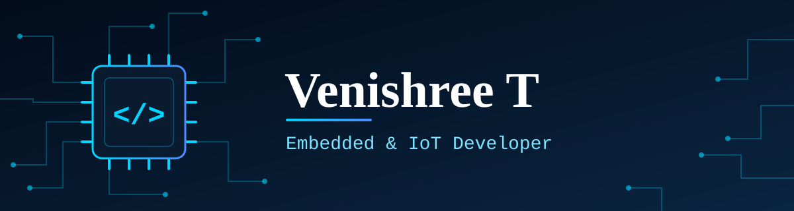

<p align="center">
  
</p>

<p align="center">
  
  <a href="mailto:venishree.2006@gmail.com"></a>
  <a href="https://www.linkedin.com/in/venishreet"></a>
</p>

---

## 👩‍💻 About Me
*A little introduction, the programmer's way.*

```c
#include <stdio.h>

typedef struct {
    char *name;
    char *role;
    char *interests[3];
    char *recharge[4];
    char *motto;
} Engineer;

int main(void) {
    Engineer venishree = {
        .name      = "Venishree",
        .role      = "Final-year ECE Student",
        .interests = {"Embedded Systems", "IoT", "AI & ML"},
        .recharge  = {"Listening to music", "Writing poems",
                      "Watching movies", "Classical dancing"},
        .motto     = "Turning code into circuits ⚡"
    };

    printf("Name      : %s\n", venishree.name);
    printf("Role      : %s\n", venishree.role);
    printf("Interests : %s | %s | %s\n",
           venishree.interests[0], venishree.interests[1], venishree.interests[2]);
    printf("Recharge  : %s | %s | %s | %s\n",
           venishree.recharge[0], venishree.recharge[1],
           venishree.recharge[2], venishree.recharge[3]);
    printf("Motto     : %s\n", venishree.motto);
    return 0;
}
```

---

## 🚀 Featured Projects

| 🌱 Smart Agriculture Digital Twin | 📡 Smart Channel Recommendation | 🧠 AI Mental Health Agent |
|:---|:---|:---|
| IoT-based digital twin for monitoring farm conditions. Built for the **Naan Mudhalvan Ingage Hackathon**. | Real-time IoT system that analyses WiFi congestion and recommends the most efficient channel. | Capstone for the **Google × Kaggle AI Intensive 2025**: a mental health support agent. |
| **Tech:** C++ • IoT | **Tech:** C++ • IoT | **Tech:** Python • Jupyter |
| [](https://github.com/venishree1624/Smart-Agriculture-Digital-Twin) | [](https://github.com/venishree1624/smart-channel-recommendation-system) | [](https://github.com/venishree1624/AI-Mental-Health-Agent-Capstone) |

---

## 🛠️ Tech Stack

**Embedded & Hardware**


**Programming & AI**


**Tools**


---

<p align="center"><i>Always learning, always building. ⚡</i></p>
